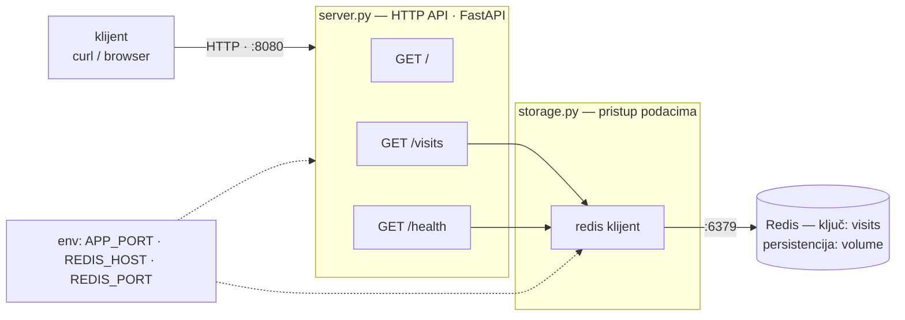
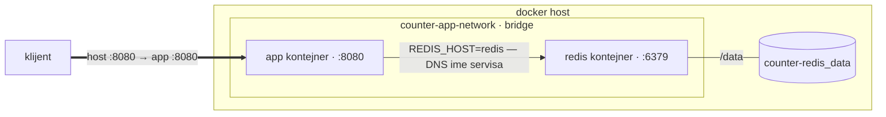
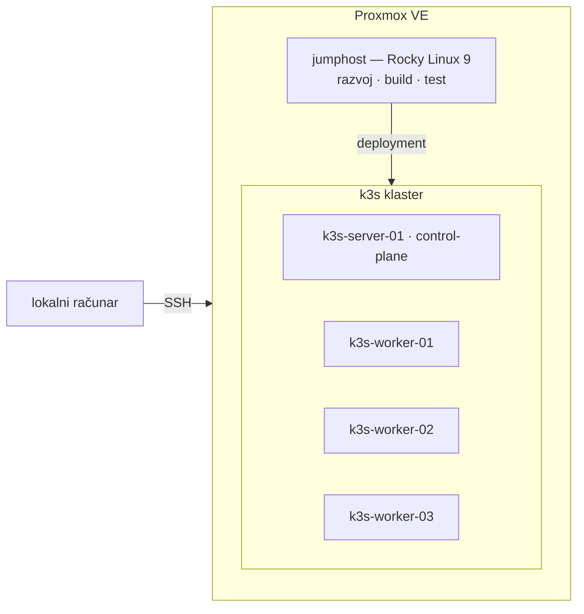

# Visit Counter App - DEMO


## O projektu

Ovaj projekat je aplikacija koja broji posete i čuva brojač u Redis bazi. 
Projekat je rađen kao zadatak za DevOps praksu, pa je cilj bio da se akcenat 
stavi na sve što okružuje samu aplikaciju: kontejnerizaciju, orkestraciju, 
automatizaciju i dokumentaciju celog procesa.

Urađeno je sledeće: aplikacija je kontejnerizovana, a celo okruženje — aplikacija i Redis — 
podiže se jednom komandom (`docker compose up`), pri čemu podaci o posetama 
preživljavaju restartove i `docker compose down` zahvaljujući named volume-u.

Svaka izmena prolazi kroz CI pipeline (GitHub Actions): lint, testovi i build 
Docker image-a, a po spajanju u `main` image se automatski objavljuje na 
GHCR-u, označen SHA-om commit-a iz kog je nastao.

Razvoj je vođen kroz GitHub Flow — svaka celina na svojoj grani, kroz pull 
request — pa istorija commit-a prati razvoj projekta od početka do kraja.

## Tehnologije koje su upotrebljene prilikom izrade

| Tehnologija | Namena |
|---|---|
| **Python 3.12 / FastAPI** | aplikacija — tri endpointa |
| **Redis** | čuva brojač poseta |
| **Docker / Docker Compose** | kontejnerizacija i podizanje celog okruženja |
| **GitHub Actions** | CI — lint, testovi, build |
| **GitHub Container Registry** | objavljivanje image-a |

## Alati koji su upotrebljeni prilikom izrade

- **[Zed IDE](https://zed.dev/)** — editor korišćen kroz SSH remote sesiju: editor 
  na lokalnoj mašini (macOS), kod na razvojnom serveru
- **[Termius](https://termius.com/)** — SSH klijent za pristup razvojnom serveru 
  (Rocky Linux 9)- više o samom okruženju u sekciji o arhitekturi
- **Z.ai — GLM 5.3** — LLM model korišćen tokom celog projekta. Korišćen se za 
  preispitivanje kritičnih delova koda, pojašnjenja vezana za arhitekturu i dizajn 
  aplikacije, kao i za pomoć pri generisanju dokumentacije (opisi pull request-ova). 
  Primenjivan kako bi mi pomogao da pronađem bezbednosne propuste i 
  potencijalne ranjivosti u kodu, kao i za predloge za unapređenje performansi 
  aplikacije za buduće projekte.
- **[Mermaid](https://mermaid.js.org/)** — izrada dijagrama arhitekture

## Materijali i izvori

**Dokumentacija:**
- [Docker](https://docs.docker.com/) — zvanična dokumentacija
- [FastAPI](https://fastapi.tiangolo.com/) — zvanična dokumentacija
- [redis-py](https://redis.readthedocs.io/) — zvanična dokumentacija
- [GitHub Actions](https://docs.github.com/en/actions) — zvanična dokumentacija
- [Bash](https://www.gnu.org/software/bash/manual/bash.html) — zvanična dokumentacija

**Literatura:**
- Agarwal, G. — *Moderne DevOps prakse*, 
  Packt, 2024 — najveća pomoć tokom izrade projekta. Najviše korišćena 
  poglavlja 2, 3, 4, 5 i 13: savremene git prakse, kontejnerizacija, 
  GitHub Actions i Kubernetes.


## Arhitektura aplikacije i razvojnog okruženja

### Arhitektura aplikacije



### Docker arhitektura



Okruženje čine dva kontejnera na zajedničkoj bridge mreži:

- **app** — FastAPI + Uvicorn na `python:3.12-alpine` image,
  jedini port izložen ka hostu (`8080`)
- **redis** — `redis:7.0.1-alpine`, dostupan samo unutar mreže; podaci u 
  named volume-u

Aplikacija se pokreće tek kada Redis prođe healthcheck (`depends_on: 
service_healthy`).

Razlozi pojedinačnih odluka (alpine baza, volume, non-root...) 
navedeni su u [sekciji o ključnim odlukama](#objašnjenje-važnih-odluka).

### Razvojno okruženje



Razvoj je vođen na daljinu: editor (Zed) i SSH klijent (Termius) na macOS-u, 
a kod, build i testiranje na udaljenoj mašini — jumphost-u pod Rocky Linuxom 9, 
virtuelnoj mašini na Proxmox-u. Krajnja destinacija aplikacije je k3s 
klaster (1 control plane + 3 workera), podignut na istom Proxmox hostu.

Cilj ovakvog rasporeda je što realnije okruženje: razvoj na jednom 
mestu, deployment na drugom, pristup preko SSH. Detaljna arhitektura celog 
homelab okruženja opisana je na repozitorijumu 
[stajkovic-luka/homelab](https://github.com/stajkovic-luka/homelab).

## Sadržaj repozitorijuma

counter-app-demo/
├── server.py               # FastAPI aplikacija — tri endpointa (/, /visits, /health)
├── storage.py              # pristup Redisu
├── test_app.py             # automatski test
├── requirements.txt        # zavisnosti
├── Dockerfile              # image aplikacije (single-stage, non-root)
├── Dockerfile.multistage   # multi-stage verzija Dockerfile
├── compose.yaml            # Docker compose fajl
├── .dockerignore
├── .env.example            # primer .env fajla
├── .gitignore
├── scripts/
│   └── healthcheck.sh      # skripta za proveru dostupnosti app
├── k8s/
│   ├── configmap.yaml      # konfiguracija aplikacije (env varijable)
│   ├── redis.yaml          # Redis: Deployment, Service, PVC
│   └── app.yaml            # aplikacija: Deployment, NodePort servis
└── .github/
    └── workflows/
        └── ci.yml          # CI pipeline

## Preduslovi za pokretanje aplikacije

**Za pokretanje u kontejnerima:**

- [Docker Engine](https://docs.docker.com/engine/install/) sa `docker compose` plugin-om (v2)
- [Git](https://git-scm.com/downloads)

**Za lokalno pokretanje bez Dockera, dodatno:**

- [Python 3.12](https://www.python.org/downloads/)
- [Redis](https://redis.io/docs/getting-started/) — lokalna instanca ili `docker run redis`
- **bash** i [curl](https://curl.se/download.html) — za proveru endpointa i `scripts/healthcheck.sh`

Operativni sistem: Linux ili macOS; na Windows-u [WSL2](https://learn.microsoft.com/en-us/windows/wsl/install).

## Uputstvo za pokretanje aplikacije

### 1. Podizanje u kontejnerima

```bash
git clone https://github.com/stajkovic-luka/counter-app-demo.git
cd counter-app-demo
cp .env.example .env
docker compose up -d
```

Prvi `up` gradi image aplikacije i preuzima Redis, pa može potrajati koji minut.
Proveriti da sve radi:

```bash
curl http://localhost:8080/          # {"message": ..., "host": ...}
curl http://localhost:8080/visits    # {"visits": 1} (svaki poziv uvećava)
curl http://localhost:8080/health    # {"status": "ok"}
```

Provera da brojač preživljava restart okruženja:

```bash
curl http://localhost:8080/visits    # broj N
docker compose down && docker compose up -d
curl http://localhost:8080/visits    # N+1 — podaci su u volume-u perzistentni
```

Gašenje: `docker compose down`

### 2. Lokalno pokretanje (bez Dockera za aplikaciju)

```bash
python3 -m venv .venv && source .venv/bin/activate
pip install -r requirements.txt
docker run -d -p 6379:6379 redis        # ili lokalno pokrenut Redis
uvicorn server:app --port 8080
```

Aplikacija je dostupna na `http://localhost:8080`, a testovi se pokreću sa `pytest`.

### 3. Healthcheck skripta

```bash
./scripts/healthcheck.sh http://localhost:8080
```

Skripta poziva `/health` do 5 puta sa pauzom od 3 sekunde; izlazni kod `0` znači 
da je aplikacija zdrava, `1` da nije ni posle 5 pokušaja.

## Objašnjenje važnih odluka

- **`python:3.12-alpine` pinovana verzija** — izmereno 134 MB naspram 
  235 MB sa slim varijantom. Zavisnosti su čist Python, bez kompajliranih 
  paketa. Nisam koristio `latest`, verzija je fiksna radi 
  reproduktivnog builda i predvidivog ponašanja.

- **Zavisnosti se kopiraju i instaliraju pre koda aplikacije** — kako bi se 
 iskoristio Docker build cache. Izmena koda ne ruši sloj sa zavisnostima, 
 pa build ostaje kratak kada se menja samo aplikacija, što je ćešće nego promena zavisnosti.

- **`pip install --no-cache-dir`** — pip po defaultu čuva skinute pakete u 
  sopstvenom kešu unutar image-a, što ga povećava. Docker već kešira ceo 
  sloj, pa je pip-ov keš suvišan. Izmereno, image sa pip kešom 152 MB, bez njega 134 MB.

- **Port iz env promenljive i `exec` u CMD** — `APP_PORT` sa default-om 
  omogućava promenu porta bez rebuild-a image-a. Takođe, `exec` prosleđuje signale 
  procesu, pa `docker stop` znači graceful shutdown, ne SIGKILL posle 
  timeout-a.

- **Multi-stage Dockerfile urađen, ali nije korišćen u finalnom buildu** — 
  izmereno: 134 MB (single-stage) naspram 139 MB (multi-stage). Pošto su 
  zavisnosti čist Python, nije bilo build alata za isključiti iz runtime 
  stage — multi-stage nema šta da smanji. `Dockerfile.multistage` 
  je zadržan u repozitorijumu kao dokumentovana evaluacija.

- **Named volume za Redis podatke** — brojač preživljava ne samo restart, 
  nego i brisanje kontejnera, zbog efemerne prirode 
  kontejnera. Named umesto anonimnog, kako bi podaci bili pregledni i 
  spremni u slučaju backup-a ili premeštanja.

- **Redis healthcheck sa `depends_on: service_healthy`** — aplikacija kreće 
  tek kada Redis zaista odgovori na PING, a ne kada se kontejner startovao.
  
- **Dodat `restart: unless-stopped`** kako bi kontejner preživeo crash i reboot, ali omogućio ručno zaustavljanje.

- **Image tagovan SHA-om commit-a u CI** — tagovi (npr. latest) mogu da 
  se prepišu i preusmere. SHA commit-a je jedinstven i nepromenljiv. Tako 
  svaka verzija image-a ostaje vezana za tačno stanje koda iz kog je 
  nastala, što štiti od supply chain napada, gde maliciozni image 
  može zameniti original pod istim tagom.

- **GitHub Flow i merge commit** — istorija pokazuje kada je 
  koja grana spojena u `main`, a ne samo šta je ubačeno. Svaka celina ima 
  svoj pull request, pa razvoj projekta ostaje čitljiv iz git 
  istorije, u slučaju kolaboracije sa kolegama.

## Problemi na koje sam nailazio tokom razvoja

- **Healthcheck skripta je uvek ispisivala status `000`**

Skripta je radila, ali umesto očekivanog `503` ili `200` uvek se pojavljivao kod `000`.
Ispostavilo se da ništa nije bilo pokvareno. `000` nam govori da nije bilo odgovora (port mrtav),
dok `503` znači da je port živ, ali aplikacija nije spremna. U mom slučaju, port je bio mrtav jer celo okruženje nije bilo pokrenuto, testirao sam skriptu protiv porta na kojem niko ne sluša.

- **Aplikacija u kontejneru nedostupna sa hosta (connection refused)**

Kontejner je radio, logovi su bili čisti, a curl sa hosta odbijan. Uzrok je bio što uvicorn bez
--host sluša na `127.0.0.1`, što je njegov sopstveni loopback, dok komanda -p dolazi na mrežni
interfejs kontejnera. Rešenje je bilo --host 0.0.0.0 unutar CMD, što je i preporučeni način za izlaganje aplikacije u kontejneru.

- **Promenjen port u image-u, zaboravljeno preslikavanje u compose fajlu**

Kontejner je bio pokrenut i zdrav, ali je svaki pokušaj pristupa aplikaciji sa 
računara završavao prekinutom konekcijom. Razlog je bio što sam tokom sređivanja konfiguracije promenio port na kojem aplikacija sluša (u Dockerfile-u, sa 8000 na 8080), a preslikavanje u compose fajlu je ostalo da koristi stari broj. Preslikavanje `"8080:8000"` znači: saobraćaj sa 
porta 8080 na računaru ulazi na port 8000 u kontejneru, koji niko ne osluškuje. Saobraćaj je ulazio u kontejner na prazan port i konekcija se zbog toga prekidala. Rešenje je bilo da se preslikavanje u compose fajlu uskladi.

- **Objavljivanje image-a na GHCR**

Prvi pokušaj je pao sa "installation not allowed to Create organization package" — 
GITHUB_TOKEN nije imao packages: write. Drugi pokušaj prolazi kroz upload svih slojeva, ali je manifest odbijen. Paket se "sam pojavio", pri čemu je neuspešni pokušaj ostavio slojeve i zapis
paketa u registru. Treći pokušaj, re-run, prolazi u potpunosti. Razlog je što nije bilo kreiranja,
već upis u postojeći paket.

- **Preimenovanje volume-a resetovalo brojač**

Posle preimenovanja volume-a u compose fajlu, brojač poseta je resetovan. Uzrok je bio
što Docker ne preimenuje volume, već pod novim imenom kreira novi, 
prazan, a stari ostaje u sistemu sa starim podacima. Rešenje je svestan izbor 
imena i uklanjanje zastarelog volume-a.

## Šta bih unapredio da imam više vremena

- **`dev` grana kao međustepen ka `main`-u** — sve promene bi se prvo 
  spajale u `dev`, gde bi ceo pipeline stvarno odradio svoj posao, pa tek 
  onda u `main`. Na taj način bi se izbegla situacija koju sam imao tokom projekta,
  gde bi main padao i time blokirao dalji razvoj, jer je CI pipeline na main-u bio jedini koji je radio build i objavljivao image.

- **Složenija aplikacija** — više logike, više endpoint-a i više tačaka koje 
  mogu da otkažu. Time bi i DevOps strana projekta bila dosta teža: složeniji 
  build, više testova za održavanje, bogatiji pipeline.

- **Rigorozniji testovi** — pokriti i failure putanje (`503` ponašanje kada 
  Redis nedostaje) i preostale endpoint-e, uz Redis kao service container u 
  CI-u, čime bi testiranje prestalo da zaobilazi zavisnosti.

- **CD deo lanca (npr. Argo CD)** — CI se već završava objavom image-a na GHCR-u, a
  sledeći korak bi bio GitOps. Deployment novih verzija na klaster automatski, 
  gde git ostaje jedini source of truth. Bila bi dobra prilika da 
  praktično eksperimentišem i savladam GitOps.

- **Nginx reverse proxy ispred aplikacije (bonus zadatak)**

- **Provera manifesta na upravljanom klasteru (EKS/ECS)** — prilika da 
  proverim prenosivost onoga što radi lokalno i proširim iskustvo na 
  upravljane Kubernetes servise.

- **SonarQube u CI** — automatska provera koliki je deo koda pokriven 
  testovima, koliko je kod složen i da li sadrži poznate loše prakse. 
  Ako kod ne zadovolji zadate granice, build pada i time loš kod
  zaustavljamo da ne dođe do main grane.
